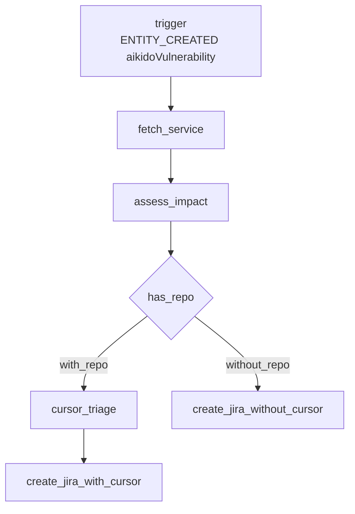
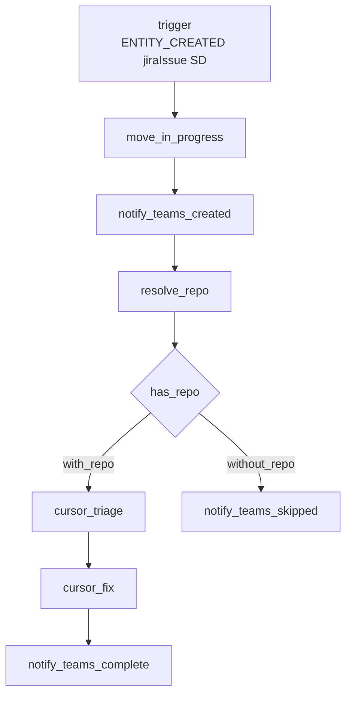
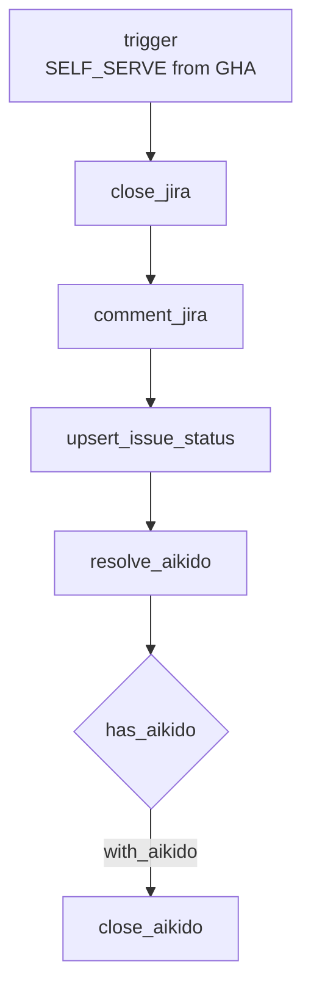

# terraform-sdlc-agentic-bugfix-root-module

Composes the `terraform-port-workflow` child module three times to manage the live
Port EU SDLC agentic bugfix workflows, plus a `terraform-port-dashboard` child module
for the Agentic Fix Velocity dashboard. All three workflows use category **`Agentic Triage`**.

1. `aikido_vuln_cursor_triage_jira` — Aikido vulnerability → Cursor remediation → Jira SD
2. `jira_sd_teams_cursor_autofix` — Jira SD → Teams → Cursor triage → Cursor fix
3. `jira_close_on_pr_merged` — GitHub Actions callback → close Jira + sync Port entity + close matched Aikido finding
4. `agentic_fix_velocity` — DORA-aligned discovery-to-fix velocity dashboard

## Pipeline overview

```text
Aikido → SD ticket → Cursor autofix → PR merge → Done
```

| Stage | Workflow | What happens |
| ----- | -------- | ------------ |
| Detect | `aikido_vuln_cursor_triage_jira` | New Aikido vuln → impact assess → optional Cursor PR → open Jira SD ticket |
| Autofix | `jira_sd_teams_cursor_autofix` | New SD issue → Teams notify → Cursor triage + fix PR on `bugfix/<KEY>` |
| Close | `jira_close_on_pr_merged` | GHA on PR merge → Jira Done + comment + Port entity sync + Aikido Fixed |

## Architecture

```text
Pipeline environment variables
  └── Port provider
        ├── terraform-port-workflow child module (×3)
        │     ├── aikido_vuln_cursor_triage_jira
        │     ├── jira_sd_teams_cursor_autofix
        │     └── jira_close_on_pr_merged
        └── terraform-port-dashboard child module
              └── agentic_fix_velocity (widgets from dashboards/*.json)
```

The root owns provider configuration, the three workflow definitions (`data_*.tf`),
and the dashboard widget envelope (`dashboards/agentic_fix_velocity.json`).
The workflow child module owns each `port_workflow` resource; the dashboard child
module owns the `port_page` resource.

Child module sources:

```text
github.com/port-experimental/terraform-port-workflow?ref=1.0.2
git::https://github.com/port-experimental/terraform-port-dashboard.git?ref=1.0.0
```

> [!CAUTION]
> **Beta features**
> Port dashboard pages require `PORT_BETA_FEATURES_ENABLED=true` in the Terraform
> pipeline environment. Set it alongside `PORT_CLIENT_ID` / `PORT_CLIENT_SECRET`.

---

## 1. `aikido_vuln_cursor_triage_jira` (category: Agentic Triage)

**Trigger:** `ENTITY_CREATED` on blueprint `aikidoVulnerability`

**Flow:** `trigger → fetch_service → assess_impact → has_repo → (with_repo) cursor_triage → create_jira_with_cursor | (without_repo) create_jira_without_cursor`



| Node | Type | Role |
| ---- | ---- | ---- |
| `trigger` | EVENT_TRIGGER | Fires on new `aikidoVulnerability` entity |
| `fetch_service` | WEBHOOK | Loads related `service` (github_url, default_branch, criticality); continues on failure |
| `assess_impact` | AI | Structured impact/severity/actions from vuln + service context |
| `has_repo` | CONDITION | Branches on whether `github_url` is present |
| `cursor_triage` | INTEGRATION_ACTION (Cursor) | Remediates via PR into service `default_branch`; continues on failure |
| `create_jira_with_cursor` | WEBHOOK (Jira) | Opens SD ticket including Cursor agent/PR links |
| `create_jira_without_cursor` | WEBHOOK (Jira) | Opens SD ticket noting Cursor was skipped (no repo) |

---

## 2. `jira_sd_teams_cursor_autofix` (category: Agentic Triage)

**Trigger:** `ENTITY_CREATED` on blueprint `jiraIssue` where project == `SD`

**Flow:** `trigger → move_in_progress → notify_teams_created → resolve_repo → has_repo → (with_repo) cursor_triage → cursor_fix → notify_teams_complete | (without_repo) notify_teams_skipped`



| Node | Type | Role |
| ---- | ---- | ---- |
| `trigger` | EVENT_TRIGGER | New `jiraIssue` with project relation `SD` |
| `move_in_progress` | INTEGRATION_ACTION (Jira) | Transition issue to In Progress; continues on failure |
| `notify_teams_created` | WEBHOOK (Teams) | Channel card for new SD ticket; continues on failure/timeout |
| `resolve_repo` | AI | Maps issue → service + `github_url` + `default_branch` |
| `has_repo` | CONDITION | Branches on resolved `github_url` |
| `cursor_triage` | INTEGRATION_ACTION (Cursor) | Triage-only agent (no PR); continues on failure |
| `cursor_fix` | INTEGRATION_ACTION (Cursor) | Implements fix on `bugfix/<JIRA-KEY>` and opens PR; continues on failure |
| `notify_teams_complete` | WEBHOOK (Teams) | Posts triage + PR links; continues on failure/timeout |
| `notify_teams_skipped` | WEBHOOK (Teams) | Posts skip notice when no repo; continues on failure/timeout |

---

## 3. `jira_close_on_pr_merged` (category: Agentic Triage)

**Trigger:** Self-serve (invoked from GitHub Actions when a `bugfix/*` PR merges)

**Flow:** `trigger → close_jira → comment_jira → upsert_issue_status → resolve_aikido → has_aikido → (with_aikido) close_aikido`



| Node | Type | Role |
| ---- | ---- | ---- |
| `trigger` | SELF_SERVE_TRIGGER | Inputs: jira_issue_key, repository, pr_url, branch, merge_sha, etc. |
| `close_jira` | INTEGRATION_ACTION (Jira) | Transition issue to Done |
| `comment_jira` | WEBHOOK (Jira) | Comment with PR/merge metadata (+ Aikido Fixed note); continues on failure |
| `upsert_issue_status` | UPSERT_ENTITY | Sets Port `jiraIssue` status to Done; continues on failure |
| `resolve_aikido` | AI | Match Jira/PR to `aikidoVulnerability` via CVE/title/catalog search |
| `has_aikido` | CONDITION | Branches when `aikido_identifier` is non-empty |
| `close_aikido` | UPSERT_ENTITY | Sets matched `aikidoVulnerability` status to Fixed; continues on failure |

---

## Cross-cutting behavior

- **`default_branch` is not assumed to be `main`.** Workflows read `github_default_branch` from the service (or AI-resolved repo). Fallback is `develop`. Cursor agents are instructed to cut `bugfix/*` from that branch and open PRs into it — never invent `main` when the catalog says otherwise.
- **Teams and Cursor continue on failure.** Notification webhooks and Cursor integration nodes use `on_failure = "continue"` (and Teams also `on_timeout = "continue"`) so a flaky webhook or agent does not abort the rest of the path where a ticket/comment still matters.

---

## Prerequisites

- Terraform >= 1.5
- `port-labs/port-labs` provider >= 2.33.2 (pinned in `.terraform.lock.hcl`)
- Port EU credentials with permission to manage workflows and dashboard pages, supplied
  as environment variables. These are managed externally (for example in your CI/CD
  secret store) and are not Terraform variables:

  | Environment variable | Description |
  | -------------------- | ----------- |
  | `PORT_CLIENT_ID`     | Port client ID used to authenticate the Terraform provider. |
  | `PORT_CLIENT_SECRET` | Port client secret used to authenticate the Terraform provider. |
  | `PORT_BETA_FEATURES_ENABLED` | Must be `true` to manage Port dashboard pages. |

- Port secrets used by the live workflows (`TEAMS_WEBHOOK_URL`, Jira Atlassian token)
- Integrations: `cursor-cloud-agents`, `jira`
- Blueprints: `aikidoVulnerability`, `service`, `jiraIssue`, `githubPullRequest`, `deployment`

## Configuration

```hcl
module "aikido_vuln_cursor_triage_jira" {
  source = "github.com/port-experimental/terraform-port-workflow?ref=1.0.2"

  identifier  = "aikido_vuln_cursor_triage_jira"
  category    = "Agentic Triage"
  nodes       = local.aikido_vuln_cursor_triage_jira.nodes
  connections = local.aikido_vuln_cursor_triage_jira.connections
}

module "jira_sd_teams_cursor_autofix" {
  source = "github.com/port-experimental/terraform-port-workflow?ref=1.0.2"

  identifier  = "jira_sd_teams_cursor_autofix"
  category    = var.category # default: "Agentic Triage"
  nodes       = local.jira_sd_teams_cursor_autofix.nodes
  connections = local.jira_sd_teams_cursor_autofix.connections
}

module "jira_close_on_pr_merged" {
  source = "github.com/port-experimental/terraform-port-workflow?ref=1.0.2"

  identifier  = "jira_close_on_pr_merged"
  category    = var.category # default: "Agentic Triage"
  nodes       = local.jira_close_on_pr_merged.nodes
  connections = local.jira_close_on_pr_merged.connections
}

module "agentic_fix_velocity_dashboard" {
  source = "git::https://github.com/port-experimental/terraform-port-dashboard.git?ref=1.0.0"

  identifier  = "agentic_fix_velocity"
  title       = "Agentic Fix Velocity"
  icon        = "Health"
  locked      = false
  parent      = var.dashboard_parent
  widgets     = [file("${path.module}/dashboards/agentic_fix_velocity.json")]
}
```

Workflow identifiers match the live Port EU workflows, which have already been
imported into state. To manage them from a fresh state, import them first:

```bash
terraform import module.aikido_vuln_cursor_triage_jira.port_workflow.main aikido_vuln_cursor_triage_jira
terraform import module.jira_sd_teams_cursor_autofix.port_workflow.main jira_sd_teams_cursor_autofix
terraform import module.jira_close_on_pr_merged.port_workflow.main jira_close_on_pr_merged
```

### Dashboard widget envelope

`dashboards/agentic_fix_velocity.json` is a Port `dashboard-widget` envelope
(`id`, `type`, `layout`, `widgets`) exported from the live EU page. The module
passes it via `file(...)` to the dashboard child module. Edit the JSON (or
re-export from Port) when changing charts; keep widget `id`s aligned with
`layout` column ids.

## Usage

```bash
export PORT_CLIENT_ID=...
export PORT_CLIENT_SECRET=...
export PORT_BETA_FEATURES_ENABLED=true

terraform init
terraform validate
terraform plan
```

State is local by default. `provider.tf` contains a commented-out S3 backend
(`encrypt` and `use_lockfile` enabled); uncomment it and set the bucket, key and
region to store state remotely, then run `terraform init -migrate-state`.

Use `terraform init -upgrade` only when deliberately bumping the provider, and commit
the updated `.terraform.lock.hcl`.

## Inputs

- `jira_cloud_id` — Atlassian cloud ID of the Jira site (required). Find it at
  `https://<your-site>.atlassian.net/_edge/tenant_info`.
- `category` — Default category for workflows that do not set an explicit override
  (max 40 characters). Defaults to `Agentic Triage`. The Aikido workflow also uses
  `Agentic Triage` explicitly.
- `dashboard_parent` — Parent page for the Agentic Fix Velocity dashboard. Defaults
  to `dashboards`.

## Outputs

- `aikido_vuln_cursor_triage_jira_id` / `_identifier`
- `jira_sd_teams_cursor_autofix_id` / `_identifier`
- `jira_close_on_pr_merged_id` / `_identifier`
- `agentic_fix_velocity_dashboard_identifier` / `_parent`
