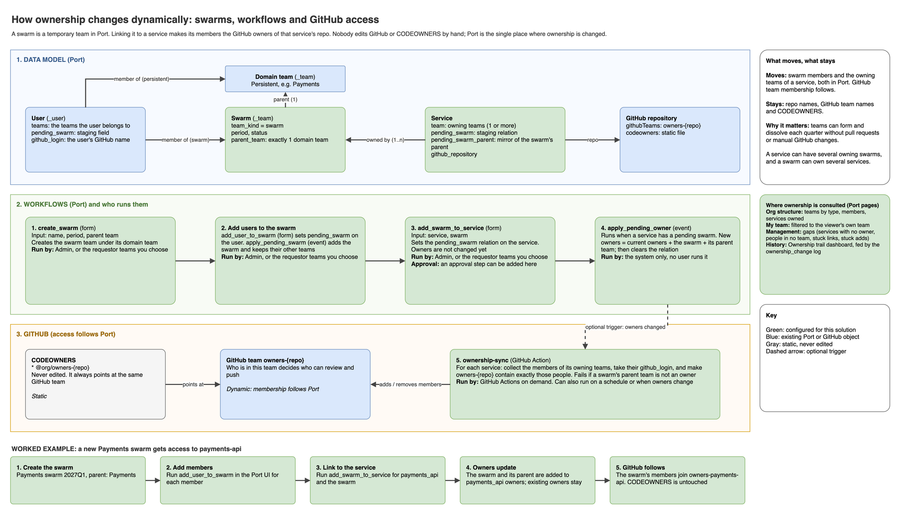
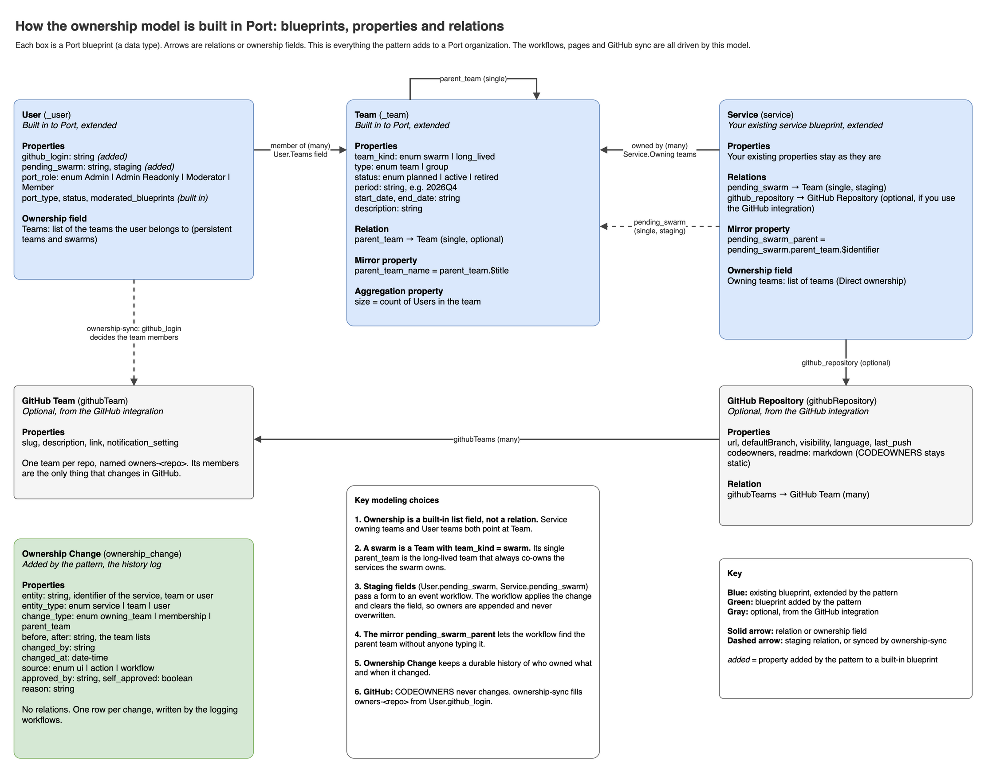

# Dynamic ownership

Let teams form, change, and dissolve without anyone editing GitHub teams or `CODEOWNERS` by hand.

Ownership in most organizations is static: a service has an owning team, `CODEOWNERS` names a GitHub team, and both go stale the moment people move. This pattern makes **Port the single place where ownership changes**. A temporary team (a *swarm*) is linked to a service in Port. GitHub access then follows automatically, while `CODEOWNERS` never changes and every change leaves an audit record.

## The idea

| Piece | Stays the same | Changes |
|---|---|---|
| `CODEOWNERS` | Always points at the GitHub team `owners-<repo>` | Never edited |
| GitHub team `owners-<repo>` | Name, and the fact that it exists | Its members, kept in sync with Port |
| Port teams and service owners | Long-lived domain teams | Swarms come and go, quarter by quarter |

A swarm always has exactly one **parent domain team**, and that parent co-owns every service the swarm owns. Domain teams own services for the long term. Swarms add temporary, focused ownership on top.

## How it works

1. **Create a swarm** in Port with a form: name, period (for example `2026Q4`) and parent team.
2. **Add users** to the swarm with a form. The user's existing teams are kept.
3. **Link the swarm to a service** with a form. The swarm and its parent team are appended to the service's owners. Existing owners stay.
4. **`ownership-sync`** (a GitHub Action) reads the service's owning teams from Port, looks up each member's `github_login`, and makes the GitHub team `owners-<repo>` contain exactly those people.
5. **Every change is recorded** as an `ownership_change` entity, shown on an Ownership trail dashboard.

### Why two workflows for each change

A Port workflow can only replace a list, not append to it. To add a team to a service without overwriting the existing owners, each change is split in two:

- A **form** workflow only *stages* the change on the entity (`pending_swarm`).
- An **event** workflow fires on that update, builds the new list from the current owners plus the staged value, writes it, and clears the staging field.

The Management dashboard lists any entity where staging did not finish, so a failed event workflow never goes unnoticed.

## Data model

The pattern adds the following to your Port organization. Nothing built in is removed.

| Blueprint | What is added |
|---|---|
| `_team` (built in) | `team_kind` (`swarm` or `long_lived`), `status`, `period`, `start_date`, `end_date`; relation `parent_team` to `_team`; mirror property `parent_team_name`; aggregation property `size` (count of users in the team) |
| `_user` (built in) | `github_login`; staging field `pending_swarm` |
| your service blueprint | staging relation `pending_swarm` to `_team`; mirror property `pending_swarm_parent`; Direct ownership (the `team` field) |
| `ownership_change` (new) | `entity`, `entity_type`, `change_type`, `before`, `after`, `changed_by`, `changed_at`, `source`, `approved_by`, `self_approved`, `reason` |

Ownership is Port's built-in `team` field, not a relation: a service's `team` lists its owning teams and a user's `team` lists the teams they belong to.

## What is included

| Piece | What it is |
|---|---|
| 5 workflows | `create_swarm`, `add_user_to_swarm`, `apply_pending_swarm`, `add_swarm_to_service`, `apply_pending_owner` |
| 2 audit workflows | `log_service_owner_change`, `log_user_team_change` |
| 4 dashboards (optional) | Org Structure, My Team, Management (gaps and stuck changes), Ownership trail |
| GitHub Action | `ownership-sync`, with dry-run and apply modes |

The pattern is delivered three ways. Pick one for Port, and add the GitHub sync either way.

| Folder | Use it when |
|---|---|
| [`terraform/`](terraform) | You manage Port with Terraform. Provider-native resources, one `terraform apply`. |
| [`port-cli/`](port-cli) | You want a script. One idempotent `apply.sh` built on the Port CLI, no state to manage. |
| [`github-sync/`](github-sync) | Always. The GitHub Action that keeps `owners-<repo>` in step with Port. |

## Prerequisites

- A Port organization with [client credentials](https://docs.port.io/build-your-software-catalog/custom-integration/api/#get-api-token), and admin rights to change blueprints.
- A **service blueprint** (the pattern is written against one called `service`; you can use another name). It needs **Direct ownership**, which gives it the `team` field. Inherited ownership will not work, because the workflows write the `team` list directly.
- Port **users and teams** in the catalog. Users normally arrive through SSO. Each person who should get GitHub access needs `github_login` set on their `_user` entity.
- For the GitHub sync: a GitHub organization, a **GitHub App** with Members read and write permission on the organization, and one team per repository named `owners-<repo>` that `CODEOWNERS` points at. The sync never creates or deletes teams.

## Try it

After installing, check the whole loop in a sandbox organization:

1. Run **Create swarm** with name `Demo`, period `2026Q4` and an existing team as parent. A `_team` entity appears with `team_kind = swarm`.
2. Run **Add user to swarm** for a user who has a `github_login`. Their `team` list gains the swarm, and `pending_swarm` returns to empty.
3. Run **Add swarm to service** for a service. The service's owners gain the swarm **and** its parent team, and `pending_swarm` clears.
4. Open **Ownership trail**. You should see a row for the service change and a row for the membership change.
5. Run `ownership-sync` with `mode = dry-run`, then `apply`. The members of `owners-<repo>` now match the owners in Port.

## Design rules worth knowing

- **A swarm has exactly one parent.** The parent co-owns the service, so a domain team never loses visibility of a service its swarm owns. `ownership-sync` fails if a swarm owns a service without its parent as an owner.
- **Appends, never overwrites.** Existing owners and existing teams are kept.
- **The sync only changes membership** of existing `owners-<repo>` teams. It refuses to run if Port resolves no members, so it can never empty a team by accident.
- **Run dry-run first.** The diff is written to the job summary.

## Limits

- **No removal flows.** The workflows add swarms to users and services. Removing a user from a swarm, retiring a swarm, or taking a swarm off a service is done by editing the entity in Port. The audit workflows record those edits and the next sync updates GitHub.
- **The sync is not scheduled.** It runs on demand from GitHub Actions. Triggering it from Port when owners change, or on a schedule, is not included.
- **No approval step.** Any user who can run the forms can change ownership. Port workflows support approval nodes, so you can add one in front of `add_swarm_to_service`.
- **The sync reads all users and teams in one call each.** Very large catalogs may need pagination added to the script.
- **Pages are optional.** They are created through the API, so apply them in a sandbox organization first.
- **One caveat for Terraform users.** The two event workflows append to a list through a template in the entity's `teams` mapping. Check the `terraform plan` and the first run in a sandbox organization. See [`terraform/README.md`](terraform/README.md).

## Make it yours

- **Other service blueprint name:** set `service_blueprint_identifier` (Terraform) or `SERVICE_BLUEPRINT` (CLI).
- **Who can run the forms:** set `workflow_requestor_teams` (Terraform) or `REQUESTOR_TEAMS` (CLI). Admins can always run them.
- **Other CI or Git host:** `github-sync/scripts/sync-owners.mjs` only needs Node 20 and environment variables. The workflow file is a thin wrapper around it.
- **Other target than GitHub:** replace the GitHub half of the script. Reading the desired members from Port is independent of it.
