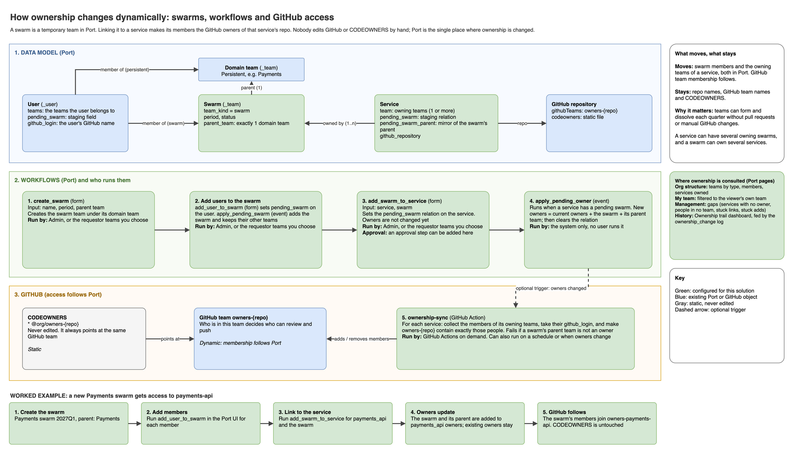
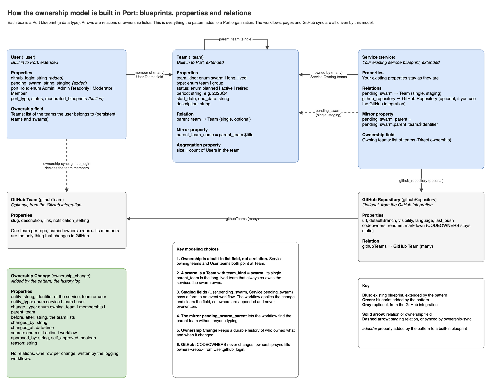

# Dynamic ownership: design

Reference for how the pattern is built. The [pattern README](../README.md) explains what it is and its limits. The [guide](../GUIDE.md) explains how to set it up.

## The ownership model

| Piece | Stays the same | Changes |
|---|---|---|
| Downstream ownership file, for example `CODEOWNERS` | Points at the owner group `owners-<repo>` | Never edited |
| Downstream owner group, for example GitHub team `owners-<repo>` | Name, and the fact that it exists | Its members, kept in sync with Port by the adapter |
| Port teams and service owners | Long-lived domain teams | Swarms come and go |

A swarm always has exactly one **parent domain team**, and that parent co-owns every service the swarm owns. Domain teams own services for the long term. Swarms add temporary, focused ownership on top.

## Why two workflows for each change

A Port workflow can only replace a list, not append to it. To add a team to a service without overwriting the existing owners, each change is split in two:

- A **form** workflow only *stages* the change on the entity (`pending_swarm`).
- An **event** workflow fires on that update, builds the new list from the current owners plus the staged value, writes it, and clears the staging field.

The Management dashboard lists any entity where staging did not finish, so a failed event workflow does not go unnoticed.

## Data model

The pattern adds the following to your Port organization. Nothing built in is removed.

| Blueprint | What is added |
|---|---|
| `_team` (built in) | `team_kind` (`swarm` or `long_lived`), `status`, `period`, `start_date`, `end_date`; relation `parent_team` to `_team`; mirror property `parent_team_name`; aggregation property `size` (count of users in the team) |
| `_user` (built in) | `github_login`; staging field `pending_swarm` |
| your service blueprint | staging relation `pending_swarm` to `_team`; mirror property `pending_swarm_parent`; Direct ownership (the `team` field) |
| `ownership_change` (new) | `entity`, `entity_type`, `change_type`, `before`, `after`, `changed_by`, `changed_at`, `source`, `approved_by`, `self_approved`, `reason` |

Ownership is Port's built-in `team` field, not a relation: a service's `team` lists its owning teams and a user's `team` lists the teams they belong to.

The `github_login` property is used by the sample GitHub adapter. An adapter for another system reads whichever identifier that system uses.

## Workflows and audit

| Workflow | Kind | Purpose |
|---|---|---|
| `create_swarm` | Self-service form | Creates a swarm `_team` with a parent team |
| `add_user_to_swarm` | Self-service form | Adds a user to a swarm, keeping the user's existing teams |
| `apply_pending_swarm` | Event (on `_user` update) | Appends the staged swarm to the user's `team` list and clears `pending_swarm` |
| `add_swarm_to_service` | Self-service form | Stages a swarm on a service |
| `apply_pending_owner` | Event (on service update) | Appends the staged swarm and its parent to the service's owners and clears staging |
| `log_service_owner_change` | Event | Writes an `ownership_change` record when a service's owners change |
| `log_user_team_change` | Event | Writes an `ownership_change` record when a user's teams change |

## Dashboards (optional)

| Page | Shows |
|---|---|
| Org Structure | People and their teams, services and owners, teams by kind |
| My Team | The signed-in user's teammates, and the services their teams own |
| Management | People in no team, services with no owner, and staged changes that did not finish (stuck adds and links) |
| Ownership trail | All ownership changes, service owner changes, and team membership changes |
